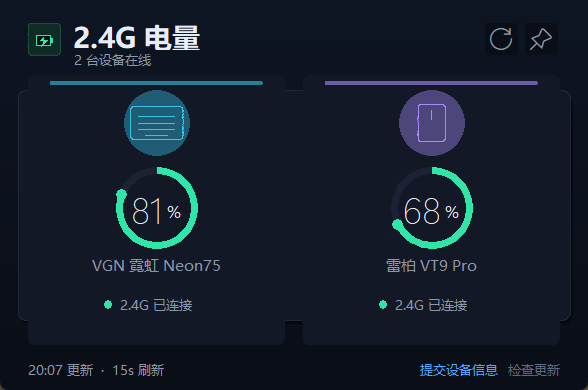

# 2.4G 电量查看器

双击 **`2.4G电量.exe`**（单文件版）就能打开。现在不再只认你的 VGN Neon75 和雷柏 VT9 Pro，会自动识别并轮询常见键鼠品牌。



## 现在支持什么

| 类别 | 支持方式 | 说明 |
| --- | --- | --- |
| VGN Neon75 | 专有适配 | `3151:5038`，65 字节 Feature Report |
| 雷柏 VT9 Pro | 专有适配 | `24AE:185A`，7 字节周期状态包 |
| Logitech 罗技 | HID++ 2.0 | Unifying / Bolt / 直连设备；兼容 Lightspeed 长报文（G304 已实测）；按设备号 1/2/0xFF 探测 |
| Razer 雷蛇 | HID Feature Report | 90 字节报告，命令类 `0x07`，电量 `0x80` / 充电 `0x84`；按型号试 4 个事务号 |
| SteelSeries 赛睿 | HID Output Report | Rival 3 Wireless 等 `1038:1830/1832/1834/1836`，命令 `AA 01`，uint16 LE 电量 |
| ASUS ROG 玩家国度 | HID Output Report | 鼠标 `0B05`，命令 `0712`，同步 65 字节报告；支持 ROG Keris / Gladius / Harpe 等 |
| MCHOSE 迈从键盘 | M HUB HID | K99 V3 / G87 V2 / G75 V2 / G98 V3 / Ace / Jet / Zero 等；`0x3837` / `0x41E4`，report 77，命令 `0x0904` |
| 标准 HID 电池 | 通用适配 | 部分 Microsoft / Apple / 蓝牙 / 2.4G 设备 |
| 其它品牌 | 识别但不猜电量 | 显示设备名和 VID/PID，状态为“已识别 · 暂不支持电量”，；右下角常驻“提交设备信息”按钮 |

> 罗技 HID++（G304 Lightspeed 已在本机实测）、雷蛇 HID、赛睿 Rival 3、ASUS ROG 和迈从 M HUB 都按公开协议/公开抓包实现，除 G304 外我手头没有对应真机实测；
> 每个设备以方块卡片显示；右下角常驻“提交设备信息”按钮，随时一键把设备信息发给我。

### 为什么不能“自动适配所有品牌”

Corsair、A4Tech / Bloody 等品牌大多使用私有 HID 协议，
不同型号甚至同一品牌的不同接收器芯片都不一样。没有对应协议文档或真机报文时，
只能识别设备名，不能安全地猜电量。我会按扫描报告逐个加适配器。

## 设备反馈（提交设备信息）

窗口右下角常驻 **提交设备信息** 按钮，点它打开反馈窗（无论设备是否已适配都能提交）：

- **发送给开发者**：一键上传，自动在 my-repository 生成 Issue；连不上时自动回退为复制 + 打开 Issue
- **复制报告**：复制到剪贴板，方便你用 QQ / 微信发我
- **保存为文件**：存到桌面，两个文件（可读文本 + 原始报告描述符）

报告只含 HID 元数据：VID/PID、usage、报告长度、设备名、Feature/Input 能力表。
**不含**键盘按键内容、文件名、剪贴板、网络信息或个人文件；只有点“发送”才联网。

### 一键上传

当前版本已内置接收端（阿里云函数计算 FC，国内直连），报告会自动变成 my-repository 里的 Issue。
程序会先尝试上传，连不上时自动回退为「复制 + 打开 Issue 预填页」。

想换成自己的接收端（换仓库 / 换地址），改 battery_viewer.py 顶部的 FEEDBACK_ENDPOINT、FEEDBACK_REPO 后重新打包即可。两种部署方式任选：

**阿里云函数计算 FC（国内直连，推荐）**：部署 feedback-aliyun.js
1. 在 GitHub 建一个 classic token，只勾 repo（或 fine-grained 只给目标仓库 Issues: Write）。
2. 阿里云函数计算控制台创建「Web 函数」，运行时 Node.js 18，入口 index.handler，粘贴 feedback-aliyun.js 内容。
3. 在环境变量加 GH_TOKEN（值 = 上一步的 token）。
4. 触发器「认证方式」改成「无需认证」，把访问地址（https://xxx.cn-hangzhou.fcapp.run）填进 FEEDBACK_ENDPOINT，重新打包。

**Cloudflare Worker（需自有域名才能国内直连）**：部署 feedback-worker.js
1. 到 Cloudflare Workers 新建 Worker，粘贴 feedback-worker.js 内容，点 Deploy。
2. 在 Settings → Variables and Secrets 加 Secret：GH_TOKEN。
3. 把 Worker 地址填进 FEEDBACK_ENDPOINT，重新打包。

## 双击报 “Could not create temporary directory!” 怎么办

单文件版启动时要先把自己解压出来。之前的版本解压到 Windows 临时目录，某些电脑会失败。
现在单文件版加了 `--runtime-tmpdir .`，改成**在 exe 所在目录解压**，退出后自动删除 `_MEIxxxx` 文件夹。

- 单文件版要放在**可写目录**（桌面、下载、本目录）
- 如果仍然报错，把 EXE 放到桌面或下载目录再试；当前只维护单文件版

## 支持设备

| 设备 | USB 识别 | 读取方式 |
| --- | --- | --- |
| VGN 霓虹 Neon75 键盘 | `3151:5038` | Feature Report，65 字节状态包 |
| 雷柏 VT9 Pro 鼠标（你说的 V9T Pro） | `24AE:185A` | 接收器 7 字节周期状态包 |
| MCHOSE 迈从键盘 | `3837:2020`（K99）等 | M HUB HID，report 77，命令 `0x0904` |
| Razer 雷蛇鼠标/键盘 | `1532:xxxx` | 90 字节 Feature Report，命令类 `0x07` |
| SteelSeries Rival 3 Wireless | `1038:1830` 等 | Output Report `AA 01`，64/65 字节 |
| ASUS ROG 鼠标 | `0B05:1A68` / `1A66` 等 | 65 字节 Output Report，命令 `0712` |
| Logitech G304 Lightspeed | `046D:C53F` 接收器 | HID++ 2.0 长报文 `0x11`，Battery Status `0x1000` |

## 使用

1. 把键盘、鼠标的接收器插在电脑上，打开鼠标电源。
2. 双击 `2.4G电量.exe`。
3. 每 15 秒自动刷新一次；点右上角刷新图标或按 **F5** 立即读取，**Esc** 关闭窗口。
4. 点右上角图钉图标可以让窗口一直显示在最前面。
5. 窗口右下角点 **提交设备信息**，把设备信息上报给我（常驻按钮，随时可提交）。
6. 窗口右下角点 **检查更新**，可以检测并一键升级到新版本（下载完成后自动替换并重启）。

关闭窗口程序就退出：没有后台驻留、没有开机自启、不写注册表；除“提交设备信息”和“检查更新”外不联网。
程序空闲时几乎不占 CPU：HID 枚举限制为每 3 秒一次，雷柏接收器走阻塞读，不会空转。
反馈文件只有手动点“保存为文件”时才生成，不是运行日志；命令行 `--scan` 才会生成 `设备扫描.txt`。

## 在线更新

窗口右下角的 **检查更新** 按钮：

1. 读取仓库里的 `version.json`，对比版本号（走 api.github.com，国内可直连）
2. 有新版本时弹窗确认，下载新 exe（`download_url`，可换成任意国内镜像地址）
3. 下载完成后自动替换当前 exe 并重启，中间不弹后台窗口

不点按钮就不联网。发布新版本只需：改 `battery_viewer.py` 里的 `APP_VERSION`，
更新仓库里的 `version.json`（改 `version` 和 `download_url`），再上传新 exe 即可。

## 界面

每台设备一张**方块卡片**，横向排布，窗口宽度会按设备数量自动调整：

- 深色科技风：深蓝黑底 + 背景渐变，键盘用青色、鼠标用紫色两套主题色
- 每张卡片中间是一个**环形电量仪表**，从顶部顺时针填充、末端带光点
- 大号百分比数字 + `%` 居中在圆环里，设备名在圆环下方
- 电量低于 20% 红色、20%–50% 琥珀色、高于 50% 薄荷绿；充电时显示蓝色
- 卡片顶部一条主题色高光线，设备图标带同色光晕
- 正常状态显示小圆点 + “2.4G 已连接”；“充电中 / 电量低 / 未连接 / 未适配”才显示胶囊
- 鼠标悬停在卡片上，显示协议、VID:PID 和本次读取时间

## 状态说明

- **2.4G 已连接**：接收器正常，读到电量；键盘和鼠标都统一显示这个状态。
- **充电中**：设备自己明确报告充电状态时才显示。
- **已识别 · 暂不支持电量**：知道设备是哪家的，但还没有它的电量协议。
- **未检测到接收器**：没有找到对应的 USB 接收器。
- **鼠标未响应**：接收器在线，但设备没有回状态；通常是鼠标关机、休眠或距离太远。
  程序不会一直死等这只鼠标：约 4 秒没首包就先让出，30 秒后再试，期间会继续识别别的鼠标。

> VT9 Pro 无线状态报文里的 `b[5]` 实测为 `0x02`；插线充电时也还是 `0x02`，
> 所以这个字节**不能判断是否在充电**。当前版本不猜充电状态，
> 鼠标无线使用和插线充电时都显示“2.4G 已连接”。

## 电量来源

- VGN：读取 `3151:5038` 的 Feature Report 0，电量在返回数据的第 3 个字节（`raw[2]`）。
- 雷柏：读取 `24AE:185A` 的 `0xFF00/0x0002` 接口，接收器每 3 秒广播 7 字节状态：
  `BB B0 42 80 0C 02 25`。
  最后一个字节 `0x25` 是电量（37%）；倒数第二个字节 `0x02` 在无线状态下也是 2，
  所以不能拿它判断充电。
- 罗技：HID++ 2.0，按 feature `0x1000/0x1001/0x1004` 读取电池百分比/电压/统一电池。
  Lightspeed 接收器（如 `046D:C53F` / G304）只认 **20 字节长报文 `0x11`**，短报文会返回错误帧；
  程序会先试长报文，再回退到 Unifying 的 7 字节短报文。
- 迈从：M HUB 私有 HID 报文，report ID `0x4D`，7 字节头（version/flags/length/command/bizCode/sequence），
  命令 `0x0904`，回复数据第 1 字节是充电状态、第 2 字节是电量。
- 雷蛇：90 字节 Feature Report，命令类 `0x07`、电量命令 `0x80`、充电命令 `0x84`；
  电量原始值 0–255，按比例换算成百分比。
- 赛睿：Rival 3 Wireless 的 `AA 01` 命令，回复前两字节为 uint16 小端电量（0–100），
  第 3 字节为充电状态。
- ASUS ROG：同步发送 65 字节 `00 12 07 ...`，回复第 5 字节是电量、第 6 字节是充电状态。
- 标准 HID：按 HID Battery usage 从 Feature Report 解析，通常电量是 0–100。

## 从源码运行

需要 Python 3.10+，只用标准库（ctypes + tkinter），无第三方运行时依赖。

```bat
python battery_viewer.py
```

只看读数、不开窗口：

```bat
python battery_viewer.py --diag
```

生成 HID 设备扫描报告（写到桌面）：

```bat
python battery_viewer.py --scan
```

## 重新打包

推荐打包成单文件，并把临时解压目录固定在 exe 所在目录：

```bat
python -m pip install pyinstaller pillow
python make_icon.py
python -m PyInstaller --noconfirm --clean --onefile --windowed ^
  --name "2.4G电量" --icon app.ico --manifest app.manifest ^
  --runtime-tmpdir . battery_viewer.py
```

生成 `dist\2.4G电量.exe`，复制到本目录即可使用。

> 这个 EXE 没有代码签名，首次运行 Windows SmartScreen 可能提示“未知发布者”。
> 点“更多信息 → 仍要运行”即可。源码就在同目录，也可以按上面的命令自行打包。

## 要不要做代码签名？

可以，但签名和“临时目录报错”是两回事：

- **签名能解决的**：把 “未知发布者” 换成证书里的名字，降低 SmartScreen / 未知发布者的提示。
- **签名不能解决的**：`Could not create temporary directory!`、杀软误报、缺 `_internal` 文件夹导致的运行错误。
- 普通的**自签名证书**在别人电脑上仍然不受信任，不能当解决方案。

如果需要正式签名，需要从 CA 买一张代码签名证书（OV 或 EV），拿到 `.pfx` 或硬件 U 盘证书后，用 Windows SDK 的 `signtool` 给最终 EXE 签名，例如：

```bat
signtool sign /fd SHA256 /tr http://timestamp.digicert.com /td SHA256 ^
  /a /f my-cert.pfx /p <证书密码> "2.4G电量.exe"
```

签名时务必加时间戳（`/tr`），否则证书过期后签名也会失效。有证书文件的话，我可以帮你把签名步骤加进打包脚本。

## 文件

- `2.4G电量.exe`：单文件版，直接双击（放在可写目录）
- `battery_viewer.py`：界面、扫描与各品牌适配器
- `hid_win.py`：纯 ctypes 的 Windows HID 封装
- `app.manifest`：DPI 感知声明
- `app.ico` / `make_icon.py`：图标
- `screenshot.png`：README 里的界面截图
- `feedback-aliyun.js`：设备反馈接收端（阿里云函数计算 FC，国内直连，当前默认）
- `feedback-worker.js`：设备反馈接收端（Cloudflare Worker，可选）
- `version.json`：在线更新的版本号与下载地址
